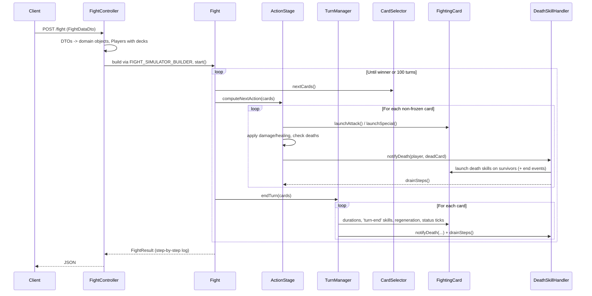

# Architecture

## Language/Framework

- **Stack**: Node.js, NestJS 11 → @packages/combat-engine/package.json
- **API**: REST, a single `POST /fight` endpoint (@packages/combat-engine/src/fight/http-api/fight.controller.ts)
- **Style**: DDD / hexagonal — domain (`src/fight/core/`) isolated from HTTP (`src/fight/http-api/`)
- **State**: none. No database, no cache; a fight is simulated in memory per request
- **DTOs**: `class-validator` decorators in `http-api/dto/fight-data.dto.ts`
- **Tests**: Jest, unit tests in `__tests__` next to the source
- **File tree**: see [CODEBASE_STRUCTURE.md](../CODEBASE_STRUCTURE.md) (single source for paths)

### Naming Conventions

Files kebab-case · classes/types PascalCase · functions/variables camelCase · constants UPPER_CASE · private methods camelCase with `private`.

## Fight Simulation Flow

## Key Patterns

- **Factory**: `FIGHT_SIMULATOR_BUILDER` builds `Fight` with its dependencies. `buildTargetingStrategy()`, `buildDodgeStrategy()`, `buildTriggerStrategy()` map DTO enums to domain objects.
- **Strategy**: card selectors (`PlayerByPlayer`, `SpeedWeighted`), targeting strategies, dodge behaviors.
- **Observer**: `CardDeathSubscriber`; `DeathSkillHandler` implements it (see Death cascade).
- **Value objects**: immutable attack effects, buffs, debuffs, damage compositions.
- **Rich domain model**: `FightingCard` owns stats, behaviors, element and every state mutation (shield, stance, concealment, protection, marks, bleed…).
- **Separation of concerns**: `Fight` orchestrates · `ActionStage` resolves attacks/heals, fires reactive skills and damage events · `TurnManager` handles turn end · `CardSelector` orders turns · `EndEventProcessor` removes event-bound buffs/effects · `skillResultsToSteps()` and `triggerReactiveSkills()` are shared pure functions.
- **Fail fast**: invalid input throws (unknown kind, unknown basis, missing property); no silent fallback.

## Damage and Stats

- **Multi-damage**: `DamageCalculator` sums `DamageComposition` (type + rate); `ElementalMatrix` multiplies per attacker type vs defender element; the defender mark amplifier applies after the matrix and before defense.
- **Defense penetration**: optional `defensePenetration` in `[0, 1]` (throws outside); defense subtracted = `actualDefense × (1 − p)`. Default 0. Only `CONDITIONAL_ATTACK` exposes it.
- **Damage type bonuses**: `DamageTypeBonus` (abstract, multiplier > 0) rewrites the composition rate of one damage type. Subclasses say when it is earned: `BleedStackBonus` (defender bleed stacks ≥ `minStacks`), `ConcealedBonus` (attacker concealed). `damageBonuses[]` on `SimpleAttack`/`MultipleAttack` (finisher included)/`SpecialAttack`, applied in order, so two bonuses on one type multiply. Read before the hit applies its own effects.
- **Attack power**: every read of the striker attack goes through `FightingCard.attackPower(context, defender?)` = `actualAttack × multipliers`. Heals read `actualAttack`. Poison/burn/bleed effects and `BleedExplosionSkill` pass no defender.
- **Alterations**: `AlterationDetail = Buff | Debuff` (`polarity`), types attack/defense/agility/accuracy/speed/criticalChance/regeneration/resistance, all through `computeActualStat` (critical rate capped at 1; speed changes turn order). `terminationEvent?` keeps a buff until an event fires.
- **Stack caps**: `stackId` on an alteration names a pile; `applyBuff()`/`applyDebuff()` take `AlterationStacking { id, maxStacks }`. At the cap the application returns `undefined`, nothing changes, no step. Piles are counted per polarity. No `stackId` = uncapped. Only `AlterationSkill` and `EffectTriggeredDebuff` pass a budget.
- **Conditional buffs**: `BuffApplication.condition` + `conditionMultiplier` multiply the rate when true at application time (`buff-condition-factory.ts`, e.g. `AllyPresenceCondition`). `ProbabilityCondition` gates a triggered `AlterationSkill` per event (failed roll: no target, no activation spent, no step).
- **Regeneration**: optional base stat; `FightingCard.regenerate()` heals `actualRegeneration` at turn end, before status ticks; emits `regenerated` when non-zero.
- **Resistance**: optional base stat; chance to refuse a status or debuff = `resistance / 200`. `FightingCard.resists()` is checked in `setState()` (after immunity) and `applyDebuff()` (after the stack cap), so every source is covered. Buffs are never opposed. The roll is why `FightingCard` takes a `Randomizer`.

## Skills and Events

- **Triggers**: events are strings (`turn-end`, `turn-start`, `next-action`, `fight-start`, `ally-death:<id>`, `enemy-death:<id>`, `self-death:<ownerId>`, `damage-taken-<id>`, `ally-health-<id>`, …). `DeathTrigger` is one class parameterized by prefix and card id. `DynamicTrigger` wraps an activation and a replacement trigger and stays dormant until the activation event.
- **Skill interface**: optional `tick()` and `lifecycleEndEvent()`; `launch()` takes an optional targeting override. Skills with `activationLimit` stop at the limit and emit their `endEvent`; `SkillResults.endEvent` makes the caller run `EndEventProcessor`, which removes matching buffs (`buff_removed`) and status effects (`effect_removed`) and reverts targeting overrides.
- **Gating in `launchSkills()`**: `requiredStance` and `requiresUndamaged` filter skills there rather than in `isTriggered()` — triggers stay about events and a blocked skill emits no empty step. A blocked cooldown keeps its counter.
- **Empty results report nothing**: `skillResultsToSteps()` skips empty heals/attacks/alterations/shields and attacks that struck nobody (legitimate when targeting is empty).
- **Card-bound passives** are extracted from `others[]` in the controller (`CARD_BOUND_SKILL_KINDS`), stored on `FightingCard`, and have no event or targeting: SURVIVE, DAMAGE_REDUCTION, DODGE_BONUS_DENIAL, BLEED_STACK_SCALING, BLEED_EMPOWERMENT, LOW_HEALTH_TARGET_BONUS.
- **Controller guard**: `KIND_ONLY_FIELDS` lists which kinds may carry each reserved field; any other kind gets a 400. `STANCE_SPECIAL_FORBIDDEN_FIELDS` does the same for STANCE specials.
- **Event owning its `activationCondition`**: `any-ally-health-below` and `enemy-killed` read `activationCondition.threshold` as their own trigger threshold (`ownsActivationCondition()`), so the generic ALTERATION path must not also build a condition from it (it would gate the skill on the caster health).
- **Reactive health skills**: `HealthReactiveSkill` (`isHealthReactive`, `onHealthChanged(card)`) is edge-triggered on `healthRatio` crossing a threshold, rearming on recovery. `triggerReactiveSkills()` runs after every HP change. Implemented by `ShieldSkill` and `TransformationSkill`.
- **Special result**: `Special.launch()` returns `SpecialResult { name, actionResults, buffResults, … }` for `SpecialAttack`, `SpecialHealing` and `SpecialStance`. Optional effects (buffs, shield) use their own targeting, apply after the primary action, and are skipped as a whole if one parameter is missing.
- **Multi-effect attacks**: `SimpleAttack`/`MultipleAttack` take `effects?: AttackEffect[]` (`MultipleAttack` also `comboFinisherEffects`); each effect rolls its optional `probability` independently (randomizer injected in the effect). `SpecialAttack` keeps one `effect`. `AttackResult.effects` carries every applied effect; `effect-results-to-steps.ts` maps them to steps.
- **Multi-hit special**: `SpecialAttack.hits` (default 1); each hit re-targets, rolls one shared critical and resolves through `strike()` (protector swap, dodge, damage, effect). Alterations, shield and stance apply once after the last hit.
- **Energy refund**: `EnergyRefund { amount, minAccuracyMargin }` on `SpecialAttack`; if caster accuracy − `FightingCard.agilityAgainst(attacker)` of the primary target (first defender struck, protector included) is strictly above the margin, the gauge is set to `amount` instead of 0 (`SpecialResult.energyRefund`).
- **Marked target bonus**: `MarkedTargetBonus` multiplies a special attack power when the defender already carries a mark of that type, read before the special applies its own effects.
- **Lifesteal**: `{ name, rate, remainingTurns }` buffer; `ActionStage` calls `stealLife()` per landed hit and emits one aggregated healing step.
- **Heal basis**: `applyHealing(source, target, rate, basis?)` (`skills/heal-basis.ts`) is the only heal computation. `RateBasis` (`source-attack` default | `target-max-health`) is shared with the bleed; unknown value throws. Only `HEALING` exposes it.

## Status Effects

- POISON/BURN tick damage; FREEZE and STUNT skip the action (`frozenLevel > 0 || isStunted`) and add +20% incoming damage via `applyDamageRate()`. STUNT lasts `2 × level − 1` turns, has no tick, and does not apply to a frozen or stunted card.
- **Immunity**: `setState()` returns whether the state was accepted. `StatusCategory` (`control` = freeze/stunt, `damage-over-time` = poison/burn/bleed, via `statusCategoryOf()`). `isImmuneTo()` is true under a transformation (all) or a stance listing the category. Refusals emit nothing. `FreezeAttackEffect` checks immunity before its burn interaction.
- **BLEED (stacked)**: the only status holding several stacks. `CardStateBleeding` keeps per-stack remaining turns, damage (`rate × source attack`, or `× target max health` with basis `target-max-health`, fixed at application) and termination event. It ticks the sum at turn end and drops expired stacks. `setState()` merges into the running bleed; `BleedAttackEffect` trims to `maxStacks` (nothing at the cap). A frozen card cannot receive a bleed and a freeze pauses it. `status_change` carries the stack count, `state_effect` the `remainingStacks`; an end event removes only the stacks it bound. `FightingCard.bleedStacksApplied` counts stacks actually laid.
- **Elemental mark**: `MarkAttackEffect` applies an `ElementalMark` (type, `ratePerStack`, `maxStacks`); `FightingCard` keeps one counter per type (`applyMark`, `markStacks`, `markAmplifier`). Never expires; at the cap it is a no-op. Emits `mark_applied`. It may carry a `triggeredDebuff`. Marks are not statuses: no immunity refuses them.

## Defensive Buffers (on `FightingCard`)

- **Shield**: `applyShield(rate, duration)` gives `rate × maxHealth` points. `applyFinalDamage()` returns `{ damageToHealth, shieldAbsorbed }`; the shield absorbs first. Emits `shield_broken` at 0 and `shield_expired` when `TurnManager` runs the duration out. Specials apply shields through `shieldApplication` (own targeting).
- **SURVIVE**: `SurviveSkill.tryConsume()` inside `applyFinalDamage()` absorbs a fatal blow once and leaves 1 HP (`AttackResult.survived`, `survived` step). Fires `survived` skills of the defender.
- **DAMAGE_REDUCTION**: `tryMitigate(damage)` inside `applyFinalDamage()` removes `rate` of the hit (or `undefined` when its `probability` roll fails). Order: freeze/stunt amplifiers → reduction → shield. Status ticks use `addRealDamage()` and bypass shield and reduction. Emits `damage_mitigated`.
- **PROTECTION**: `ProtectionSkill` puts its owner in front of one ally (`protect()`). The three attack skills call `Player.protectorOf(target, attacker)` right after targeting and swap the defender **before** any roll, so dodge, defense, element, shield and reduction are the guardian's. A dead guardian, or one concealed and unseen by the attacker, protects nobody. The buffer ticks on the guardian turns; recasting refreshes or moves it. An attack on all hits the guardian and its ward separately. `AttackResult.interceptedFor` → `attack_intercepted`. Emits `protection_started` / `protection_ended`. Empty targeting is a no-op that spends no `activationLimit`.
- **TRANSFORMATION**: one-shot `HealthReactiveSkill`; applies its alterations, optional lifesteal and status immunity for its duration. `TurnManager` ends it and charges an optional `endCostRate` (never below 1 HP). Emits `transformation_started` / `transformation_ended`.
- **Stance**: a named posture held for N turns (`activateStance()`, `hasStance()`, `decreaseStanceDurations()`), optionally granting immunities and `revealsConcealed`. Reactivating refreshes. Opened by a special (`stanceActivation`, `SpecialResult.stanceStarted`) or a `STANCE` skill. `TurnManager` decrements it and emits `stance_ended`. `endStance()` closes it early.
- **Concealment**: `FightingCard.isTargetableBy(attacker)` (alive, and not concealed unless the attacker holds a `revealsConcealed` stance) replaces `!isDead()` in every strategy reading the defending player, so area attacks skip it, a position attack falls back to the next card, and allies still reach it. `revealAttacker()` (`concealment-steps.ts`) ends it when the card attacks somebody (even a dodged hit); a bonus read during the attack still sees it concealed. `TurnManager` ends a timed one (`expired`). `fight-start` (launched by `Fight.start()` after step 0) opens a fight concealed.

## Death Cascade (`DeathSkillHandler`)

Phases on each death, in order: end events of lifecycle-limited skills → `self-death` on the dead card alone (what it leaves lands first) → `ally-death:<id>` on its surviving allies → `enemy-death:<id>` on the opposing survivors → `enemy-bleed-death` on the opposing survivors if a bleed tick killed it → `enemy-killed:<ratio>` on the living killer.

- `notifyDeath(player, card, cause?)`: `cause` is the `StateEffectType` of a lethal tick (bleed credited as soon as it ticked); a status tick has no killer. A card already notified is ignored.
- Steps accumulate and callers drain them with `drainSteps()` right after each death, which keeps ordering inside the action phase. `ActionStage` also takes `EndEventProcessor` (optional last parameter).
- `enemy-killed` ratio is `healthRatioBeforeLastDamage` (set at the start of `applyFinalDamage()`/`addRealDamage()`); the trigger fires only strictly under its optional threshold.
- `notifyKill`: defenders killed by the self-death phase (Legacy Bleed Explosion) start their own cascade through the whole event broker.
- A dead card keeps its stances and buffs until turn end, so `self-death` skills with `requiresStance` still run. `ProtectedAllyStrategy` and `FastestAllyStrategy` deliberately do not check the caster is alive.

## Reactive Events (`ActionStage`)

- After each landed hit, `dispatchDamageReactions()` fires `damage-taken-<id>` then `ally-health-<id>` on every playable card of the damaged team, with `FightingContext.lastAttacker` set. `DamageTakenTrigger` fires on every hit (not edge-triggered); `AllyHealthBelowThresholdTrigger` fires once per downward crossing of one named ally, `AnyAllyHealthBelowThresholdTrigger` once per crossing for any ally except its owner.
- Reactions launch through `AttackSkill.launch()` directly, never `handleAttackResult()`, so a counter attack cannot recurse. `reactionDeathSteps()` notifies deaths caused by a reactive attack (main hit, splash, execution) with the caster as killer.
- `FightingCard.lastAttacker` is set after each hit; `LastAttackerOfAllyTargetingStrategy` resolves it at launch.
- **Dynamic ally targeting**: `MostWoundedAllyStrategy` picks the caster's most wounded living ally below the threshold (caster excluded, ties in deck order, nobody on a healthy team). Paired with `any-ally-health-below` it builds a guardian power without a hard-coded id.
- **Bleed stacks applied**: after each attack of its action, `dispatchBleedStacksApplied()` launches `bleed-stacks-applied:<count>`; `BleedStacksAppliedTrigger` fires once at `stackThreshold` (own once-flag per skill instance).
- **Turn-start**: `launchTurnStartSkills()` runs after `tickSkills()` and before `isSpecialReady()`; only attacks that struck are kept, each turned into its own `AttackReport` through `handleAttackResult()`, placed before the action report. A card skipping its turn never sees it. `ConditionalAttack.energyCost` refuses below the cost and spends it only when the attack struck.
- **Undamaged since last action**: `FightingCard.beginAction()` (before `tickSkills()`) compares `receivedDamages` to its previous snapshot; `damagedSinceLastAction` holds for the whole action. Shield-absorbed hits and dodges do not count.

## Attack Add-ons (all on `ConditionalAttack` unless noted)

Order after the main hit: hit effects → execution → hit alterations → low-health debuff → splash.

- **Hit alterations**: `HitAlterations` buff/debuff each distinct defender that was hit, not dodged and still alive, once per defender (debuffs through `applyDebuff()`). Reported as `buff`/`debuff` steps after the attack step. Dedicated field because `statAlterations` requires targeting.
- **Execution** (`ConditionalAttack` and `SpecialAttack`; threshold in `]0, 1[`): each distinct defender hit, not dodged and strictly under the threshold, loses all remaining health through `execute()` → `addRealDamage()` (shield and reduction ignored) unless an unconsumed SURVIVE holds 1 HP. Runs inside `launch()`, so the defender is already dead when the result is read and the cascade follows with the attacker as killer. Reports `executed` (+ `survived`) via `executionSteps()`.
- **Low-health debuff**: debuffs the main defender (not dodged, alive, `healthRatio < threshold` after the hit) before the splash; resistance applies; reported as a `debuff` step.
- **Splash**: builds a `SimpleAttack` on `TargetAndNeighborsStrategy(center)` (primary target `interceptedFor ?? defender` and its deck neighbors, living only) when the main strike targeted somebody; dodge, protection and shield apply; reported as a second attack step.
- **Bleed detonation** (`SimpleAttack` only): after the dodge roll, `consumeBleedStacks()` and replace the compositions with one PHYSICAL composition of `ratePerStack × stacks` (`AttackResult.consumedBleedStacks`); combines with `defensePenetration`. `FirstBleedingEnemyStrategy` picks the first enemy in deck order at `stackThreshold` stacks.
- **Stance on fire**: optional `stanceActivation` opens only when the attack fires; `endsStance` closes `requiresStance` after the attack (`stanceEnded`), so it fires once per stance.
- **Dive and strike**: the dive is a `ConcealmentSkill` with `stanceActivation`, an `interval` cooldown and `requiresUndamaged`; on `next-action` `diveReport()` makes the action a `skill_steps` report (no attack, stays concealed). The strike is a `turn-start` `ConditionalAttack` with `requiresStance` + `endsStance`; striking lifts the concealment. A card stunned or frozen underground skips `turn-start`.
- **Activation limit**: `ConditionalAttack` counts only attacks that struck somebody (`activationLimit: 1` on `ally-health-below` = once per fight).

## Card-Bound Passive Details

- **DODGE_BONUS_DENIAL**: `FightingCard.dodge(attacker)` asks `attacker.deniesDodgeBonusOf(this)`; a bleeding defender then dodges with `agilityWithoutBuffs`. `agilityAgainst(attacker)` is the same value `dodge()` rolls with.
- **BLEED_STACK_SCALING**: attack × (1 + `rate` × every bleed stack on a living card of either team, capped at `maxRate`), read via `attackPower(context)`.
- **LOW_HEALTH_TARGET_BONUS**: × `1 + rate` when `defender.healthRatio < threshold` before the hit; `MultipleAttack` reads it per defender, finisher included. Multiplies with the other bonuses.
- **BLEED_EMPOWERMENT**: reads its owner stance itself (`empower(owner, { stacks, rate })`). `BleedAttackEffect` asks the **source** via `empowerBleed()` before computing damage and room; extra stacks stop at `maxStacks`; the rate is replaced, and `duration`, `basis`, `triggeredDebuff` overrides replace the effect values.
- **BUFF_TRANSFER**: `takeBuffs(type)` removes, `receiveBuffs()` copies on the heir (value, remaining duration, `stackId` kept; the heir stack pile counts them). Target resolved first: nobody targeted, buffs stay.
- **Bleed explosion (`BLEED_DETONATION` skill)**: every living bleeding card takes `rate × attackPower(context)` via `addRealDamage()` (defense ignored, once per card) and loses its stacks, reported as `consumedBleedStacks`.
